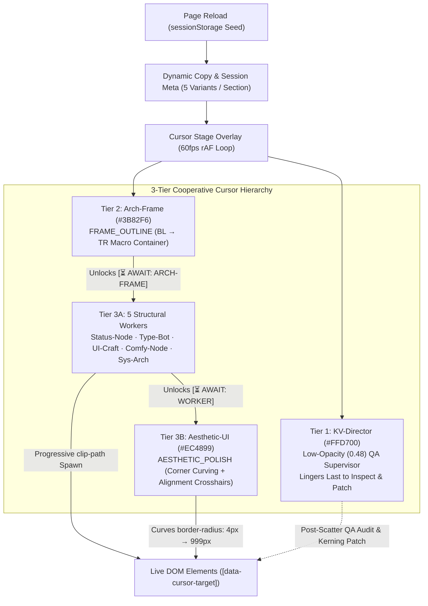

# Multi-Cursor Dynamic Canvas Assembly — Reusable Playbook & Drop-In Architecture

This document captures the complete **Cooperative Multi-Cursor Dynamic Canvas Assembly** system built for `kv-cv`. You can drop the components directly into any React / Next.js / Vite project, or copy-paste the **Master AI Prompt** in Section 1 into any coding agent to adapt this system to a new website.

---

## 1. Copy-Paste Master Prompt (For Any New Project)

Copy the block below into your AI coding assistant when starting a new website:

```markdown
# TASK: Implement "Cooperative Multi-Cursor Dynamic Canvas Assembly" Animation

Build an interactive, 60fps introductory and scroll-triggered multi-cursor canvas assembly animation inspired by Figma, CAD blueprints, and node-graph editors. Autonomous AI cursors fly across the viewport, coordinate with explicit dependency handoffs (`⏳ AWAIT`), drag directional bounding boxes, progressively spawn DOM elements & text in real time, curve button/card border radii, check smart-alignment guides, and rotate page copy on every reload.

### 1. 3-Tier Cooperative Cursor Hierarchy
1. **Tier 1 — Master Orchestrator (`KV-Director`, `#FFD700` Gold, `cursorVariant="director"`)**:
   - Low-profile, low-opacity (`maxOpacity: 0.48`) QA Supervisor with **no tether lines or connecting dots**.
   - Observes the worker swarm from a subtle vantage point, then **stays longer after the worker cursors scatter** to patrol completed DOM nodes (`h1`, cards, CTAs) and type live QA patches (`"audit(h1): fix kerning -0.02em ✓"`, `"patch(cta): center 0.0px ✓"`, `"verified: 7/7 nodes ✓"`).
   - During scroll sections, only render `KV-Director` on the **latest active section** so multiple supervisors never stack at the top of the viewport.
2. **Tier 2 — Macro Framing Cursor (`Arch-Frame`, `#3B82F6` Blueprint Blue)**:
   - Uses `FRAME_OUTLINE` (`bottom-left` -> `top-right` upward diagonal CAD drag) to construct the section's outer container frame first.
3. **Tier 3A — Specialized Structural & Content Cursors (5 Directional Creation Modes)**:
   - Inner cursors fly in early, park at their target's staging anchor with a spinning amber ring and `[⏳ AWAIT: ARCH-FRAME]` badge while waiting for their upstream dependency to finish, then execute:
     - `Status-Node` (`#A855F7` Purple) -> `CENTER_SPLIT_PILL`: Symmetric `center <-> outward` horizontal expansion for status pills, eyebrows, and filter bars.
     - `Type-Bot` (`#00E599` Emerald, `cursorVariant="ibeam"`) -> `TEXT_BASELINE_SWEEP`: Horizontal `left -> right` I-beam laser caret sweep for headings (`h1`, `h2`) and paragraphs.
     - `UI-Craft` (`#FF4444` Red) -> `RIGHT_TO_LEFT_DOCK`: `top-right -> bottom-left` reverse capsule drag for contact bars, glass cards, and drawers.
     - `Comfy-Node` (`#FFB800` Amber) -> `BOTTOM_UP_SHADER`: `bottom-right -> top-left` upward scanline fill with a live percentage counter (`0% -> 100%`) for media, bento grids, and project cards.
     - `Sys-Arch` (`#06B6D4` Cyan, `cursorVariant="crosshair"`) -> `MULTI_POINT_STAMP`: Sequential multi-waypoint clicking (`1/3 -> 2/3 -> 3/3`) across CTA button groups, navbar docks, and footer links.
4. **Tier 3B — Aesthetic & Decorative Designer (`Aesthetic-UI`, `#EC4899` Rose-Magenta, `cursorVariant="pen"`)**:
   - Uses `AESTHETIC_POLISH` mode with a custom Bézier Pen nib SVG icon.
   - Explicitly awaits structural cursors (`[⏳ AWAIT: TYPE-BOT]`, `[⏳ AWAIT: COMFY-NODE]`), then sweeps across newly created buttons, pills, textboxes, and cards to:
     - Pull corner-radius handles inward (`╭ ╮ ╰ ╯`, transitioning elements from raw `border-radius: 4px` (`data-aesthetic-polish="raw"`) to their final rounded/pill radius (`data-aesthetic-polish="polished"`)).
     - Flash Figma-style magenta smart-alignment crosshairs and live gap/center badges (`┼ ALIGN 0.0PX · R=999PX ✓`).

### 2. Mandatory Accuracy & Progressive Spawning Rules
1. **Exact Live DOM Bounding Boxes (No Height/Width Clamping)**:
   - Measure every target `[data-cursor-target="<id>"]` using `getBoundingClientRect()` inside the `requestAnimationFrame` loop so scroll and layout shifts stay 100% locked.
   - **Never** clamp marquee width or height (e.g., no `Math.min(420, rect.height)`). Selection boxes must match the exact live dimensions of the DOM element.
2. **Real-Time Progressive Text & Element Spawning (`applyProgressiveDomSpawn`)**:
   - No text or element is allowed to be visible before its cursor sweeps over it.
   - `'pending'` (before cursor `dragStart` and during `⏳ AWAIT`): `opacity: 0; clip-path: inset(0% 100% 0% 0%); pointer-events: none`.
   - `'spawning'` (`dragStart -> snapTime`): `opacity: 1` with a directional `clip-path: inset(...)` computed frame-by-frame from `marqueeRect.width / targetRect.width` and `marqueeRect.height / targetRect.height` so characters and cards physically materialize right behind the moving cursor tip.
   - `'snapped'` (`elapsed >= snapTime`): `opacity: 1; clip-path: none; pointer-events: auto`.
3. **Full-Page Coverage**:
   - Every visible element in the Hero and every scroll section (`h1`/`h2`, eyebrow badges, description textboxes, filter bars, view switchers, cards, timelines, CTA buttons, and footer blocks) must have a `data-cursor-target` attribute and an assigned cursor agent.
4. **Per-Reload Dynamic AI Copy (`sessionStorage` Rotation)**:
   - Maintain 5+ curated copy variants per section and rotate the index on every page reload via `sessionStorage` so each reload displays fresh headlines, descriptions, and live cursor typewriter commands (`typedText`).
5. **Performance & Accessibility**:
   - Use GPU-composited `transform: translate3d(x, y, 0)` on a `pointer-events: none` stage overlay (`.cursor-stage`).
   - Disable the multi-cursor swarm on mobile (`window.innerWidth < 768`) and immediately reveal all elements when `prefers-reduced-motion: reduce` is active.
```

---

## 2. System Architecture & 8 Creation Modes



### Creation Mode Reference Table

| Creation Mode | Assigned Agent | Color | Cursor SVG Variant | Drag Vector & Visual Behavior | Progressive `clip-path` Unclip Formula |
| :--- | :--- | :--- | :--- | :--- | :--- |
| `MASTER_COMMAND` | `KV-Director` | `#FFD700` Gold | `director` | Low-opacity (`0.48`) supervisor; no tether lines; lingers after workers scatter to inspect & patch nodes | N/A (Supervisor) |
| `FRAME_OUTLINE` | `Arch-Frame` | `#3B82F6` Blue | `default` | **Bottom-Left → Top-Right** CAD perimeter drag with architectural tick marks | `inset(${(1-progH)*100}% ${(1-progW)*100}% -6% -4%)` |
| `CENTER_SPLIT_PILL` | `Status-Node` | `#A855F7` Purple | `default` | **Center ↔ Outward** symmetric horizontal pill expansion with dual `◂ ▸` handles | `inset(-18% ${(1-progW)*50}% -18% ${(1-progW)*50}%)` |
| `TEXT_BASELINE_SWEEP` | `Type-Bot` | `#00E599` Emerald | `ibeam` | **Left → Right** horizontal I-beam laser caret sweep with typography baseline ruler | `inset(-18% ${(1-progW)*100}% -18% -4%)` |
| `RIGHT_TO_LEFT_DOCK` | `UI-Craft` | `#FF4444` Red | `default` | **Top-Right → Bottom-Left** reverse capsule drag with `ANCHOR (TR 1,0) ↙ BL` tag | `inset(-10% -4% ${(1-progH)*100}% ${(1-progW)*100}%)` |
| `BOTTOM_UP_SHADER` | `Comfy-Node` | `#FFB800` Amber | `default` | **Bottom-Right → Top-Left** upward scanline fill with `0% → 100%` shader badge | `inset(${(1-progH)*100}% -4% -10% ${(1-progW)*100}%)` |
| `MULTI_POINT_STAMP` | `Sys-Arch` | `#06B6D4` Cyan | `crosshair` | **Left → Right** multi-waypoint stamp (`1/3 → 2/3 → 3/3`) with numbered node pins | `inset(-15% ${(1-progW)*100}% -15% -4%)` |
| `AESTHETIC_POLISH` | `Aesthetic-UI` | `#EC4899` Pink | `pen` | **Top-Left → Center-Right** Bézier pen pass with `╭ ╮ ╰ ╯` corner-radius arcs & `┼` alignment guides | Transitions `data-aesthetic-polish="raw"` (`4px`) → `"polished"` |

---

## 3. File Structure to Copy Into Another Project

In the current repository, the complete implementation lives in 4 self-contained files plus a small CSS block:

1. **Configuration & Choreography Timelines**: [`src/components/effects/cursorConfig.js`](file:///mnt/data/Projects/kv-cv/src/components/effects/cursorConfig.js)
2. **SVG Cursor & Selection Marquee Renderers**: [`src/components/effects/SimulatedCursor.jsx`](file:///mnt/data/Projects/kv-cv/src/components/effects/SimulatedCursor.jsx)
3. **60fps Timeline Controller, Scroll Stage & Progressive DOM Spawner**: [`src/components/effects/CursorBuilder.jsx`](file:///mnt/data/Projects/kv-cv/src/components/effects/CursorBuilder.jsx)
4. **Per-Reload Dynamic AI Copy Generator**: [`src/data/dynamicCopy.js`](file:///mnt/data/Projects/kv-cv/src/data/dynamicCopy.js)
5. **Stage & Progressive Clip-Path Styles**: [`src/index.css`](file:///mnt/data/Projects/kv-cv/src/index.css#L938-L1039)

### Dependencies
```bash
npm install framer-motion
```
*(Uses React 18/19 hooks + `framer-motion` + Tailwind utility classes).*

---

## 4. Required CSS Rules (`index.css`)

Add the following CSS rules to your global stylesheet (`index.css` or `globals.css`):

```css
/* ==========================================================================
   Multi-Cursor Dynamic Canvas Assembly Stage & Wireframe Blueprint
   ========================================================================== */
.cursor-stage {
  position: absolute;
  inset: 0;
  pointer-events: none;
  z-index: 50;
  overflow: hidden;
}

.cursor-blueprint-grid {
  position: absolute;
  inset: 0;
  pointer-events: none;
  background-size: 48px 48px;
  background-image:
    linear-gradient(to right, rgba(255, 255, 255, 0.055) 1px, transparent 1px),
    linear-gradient(to bottom, rgba(255, 255, 255, 0.055) 1px, transparent 1px);
  -webkit-mask-image: radial-gradient(ellipse 85% 80% at 50% 45%, #000 40%, transparent 95%);
  mask-image: radial-gradient(ellipse 85% 80% at 50% 45%, #000 40%, transparent 95%);
}

/* Real-Time Progressive DOM & Text Spawning States */
/* IMPORTANT for Chrome/Blink: Do NOT put clip-path: inset(0% 100% 0% 0%) on "pending"
   elements before they start spawning, because Chrome's IntersectionObserver clips the
   observed rect by clip-path (yielding 0px width / 0 intersectionRatio). */
[data-scroll-assembly="pending"] {
  opacity: 0 !important;
  transform: none !important;
  pointer-events: none !important;
  transition: none !important;
}

[data-scroll-assembly="spawning"] {
  opacity: 1 !important;
  transform: none !important;
  filter: none !important;
  pointer-events: none !important;
  transition: none !important;
}

[data-scroll-assembly="snapped"] {
  opacity: 1 !important;
  transform: none !important;
  clip-path: none !important;
  -webkit-clip-path: none !important;
  filter: blur(0px) !important;
  pointer-events: auto !important;
}

/* Cooperative Aesthetic-UI (#EC4899) Corner-Radius Curving & Smart-Alignment Polish States */
[data-aesthetic-polish="raw"],
[data-aesthetic-polish="raw"] .rounded-full,
[data-aesthetic-polish="raw"] .rounded-2xl,
[data-aesthetic-polish="raw"] .rounded-3xl {
  border-radius: 4px !important;
  transition: border-radius 0.52s cubic-bezier(0.16, 1, 0.3, 1), box-shadow 0.52s ease !important;
}

@keyframes aestheticPolishFlash {
  0% {
    box-shadow: 0 0 0 1.5px rgba(236, 72, 153, 0.75), 0 0 26px rgba(236, 72, 153, 0.38);
  }
  100% {
    box-shadow: 0 0 0 0px rgba(236, 72, 153, 0), 0 0 0px rgba(236, 72, 153, 0);
  }
}

[data-aesthetic-polish="polished"],
[data-aesthetic-polish="polished"] .rounded-full,
[data-aesthetic-polish="polished"] .rounded-2xl,
[data-aesthetic-polish="polished"] .rounded-3xl {
  transition: border-radius 0.55s cubic-bezier(0.16, 1, 0.3, 1), box-shadow 0.55s ease;
}

[data-aesthetic-polish="polished"] {
  animation: aestheticPolishFlash 0.85s cubic-bezier(0.16, 1, 0.3, 1);
}

/* Accessibility Fallback */
@media (prefers-reduced-motion: reduce) {
  .cursor-stage,
  .cursor-blueprint-grid {
    display: none !important;
  }
  [data-scroll-assembly="pending"],
  [data-scroll-assembly="spawning"],
  [data-scroll-assembly="snapped"],
  [data-aesthetic-polish="raw"],
  [data-aesthetic-polish="polished"] {
    opacity: 1 !important;
    transform: none !important;
    clip-path: none !important;
    -webkit-clip-path: none !important;
    filter: none !important;
    animation: none !important;
    pointer-events: auto !important;
  }
}
```

---

## 5. Core Progressive Spawning Logic (`applyProgressiveDomSpawn`)

This function inside [`src/components/effects/CursorBuilder.jsx`](file:///mnt/data/Projects/kv-cv/src/components/effects/CursorBuilder.jsx#L34-L107) guarantees that text and containers never appear prematurely and instead materialize directly behind the moving cursor:

```javascript
function applyProgressiveDomSpawn(el, phase, mode, marqueeRect, tRect) {
  if (!el) return;

  if (phase === 'pending') {
    if (el.getAttribute('data-scroll-assembly') !== 'pending') {
      el.setAttribute('data-scroll-assembly', 'pending');
    }
    el.style.opacity = '0';
    el.style.clipPath = 'none';
    el.style.webkitClipPath = 'none';
    el.style.pointerEvents = 'none';
    return;
  }

  if (phase === 'snapped') {
    if (el.getAttribute('data-scroll-assembly') !== 'snapped') {
      el.setAttribute('data-scroll-assembly', 'snapped');
    }
    el.style.opacity = '1';
    el.style.clipPath = 'none';
    el.style.webkitClipPath = 'none';
    el.style.filter = 'none';
    el.style.pointerEvents = '';
    return;
  }

  // phase === 'spawning'
  if (el.getAttribute('data-scroll-assembly') !== 'spawning') {
    el.setAttribute('data-scroll-assembly', 'spawning');
  }

  const progW = clamp01((marqueeRect?.width || 0) / Math.max(1, tRect?.width || 1));
  const progH = clamp01((marqueeRect?.height || 0) / Math.max(1, tRect?.height || 1));

  let clip = 'none';
  if (mode === CREATION_MODES.TEXT_BASELINE_SWEEP) {
    const rightPct = ((1 - progW) * 100).toFixed(1);
    clip = `inset(-18% ${rightPct}% -18% -4%)`;
  } else if (mode === CREATION_MODES.CENTER_SPLIT_PILL) {
    const sidePct = ((1 - progW) * 50).toFixed(1);
    clip = `inset(-18% ${sidePct}% -18% ${sidePct}%)`;
  } else if (mode === CREATION_MODES.RIGHT_TO_LEFT_DOCK) {
    const leftPct = ((1 - progW) * 100).toFixed(1);
    const bottomPct = ((1 - progH) * 100).toFixed(1);
    clip = `inset(-10% -4% ${bottomPct}% ${leftPct}%)`;
  } else if (mode === CREATION_MODES.BOTTOM_UP_SHADER) {
    const topPct = ((1 - progH) * 100).toFixed(1);
    const leftPct = ((1 - progW) * 100).toFixed(1);
    clip = `inset(${topPct}% -4% -10% ${leftPct}%)`;
  } else if (mode === CREATION_MODES.MULTI_POINT_STAMP) {
    const rightPct = ((1 - progW) * 100).toFixed(1);
    clip = `inset(-15% ${rightPct}% -15% -4%)`;
  } else {
    // FRAME_OUTLINE: Bottom-Left -> Top-Right CAD perimeter expansion
    const topPct = ((1 - progH) * 100).toFixed(1);
    const rightPct = ((1 - progW) * 100).toFixed(1);
    clip = `inset(${topPct}% ${rightPct}% -6% -4%)`;
  }

  el.style.opacity = '1';
  el.style.clipPath = clip;
  el.style.webkitClipPath = clip;
  el.style.filter = 'none';
  el.style.pointerEvents = 'none';
}
```

---

## 6. How to Instrument Any Page / Component (`data-cursor-target`)

### Step 1: Instrument Hero Elements
Attach `data-cursor-target="<id>"` to each element in your Hero component and mount `<CursorTimelineController />` inside the Hero section:

```jsx
import { useState, useCallback, useRef } from 'react';
import { CursorTimelineController, useCursorAssemblyMode } from '../effects/CursorBuilder';
import { useDynamicPageCopy } from '../../data/dynamicCopy';

export function HeroSection() {
  const heroRef = useRef(null);
  const assemblyMode = useCursorAssemblyMode();
  const dynamicCopy = useDynamicPageCopy();

  const [snappedTargets, setSnappedTargets] = useState(() => new Set());
  const [polishedTargets, setPolishedTargets] = useState(() => new Set());
  const [assemblyComplete, setAssemblyComplete] = useState(false);

  const handleSnapTarget = useCallback((targetKey) => {
    setSnappedTargets((prev) => {
      if (prev.has(targetKey)) return prev;
      const next = new Set(prev);
      next.add(targetKey);
      return next;
    });
  }, []);

  const handlePolishTarget = useCallback((targetKey) => {
    setPolishedTargets((prev) => {
      if (prev.has(targetKey)) return prev;
      const next = new Set(prev);
      next.add(targetKey);
      return next;
    });
  }, []);

  return (
    <section ref={heroRef} className="relative min-h-screen overflow-hidden">
      {/* Multi-Cursor Stage Controller */}
      {assemblyMode === 'swarm' && (
        <CursorTimelineController
          containerRef={heroRef}
          onSnapTarget={handleSnapTarget}
          onPolishTarget={handlePolishTarget}
          onComplete={() => setAssemblyComplete(true)}
        />
      )}

      {/* Macro Container (Framed by Arch-Frame) */}
      <div data-cursor-target="hero-frame" className="max-w-5xl mx-auto pt-32 px-6">
        {/* Status Pill (Expanded by Status-Node, Curved by Aesthetic-UI) */}
        <div
          data-cursor-target="hero-badge"
          data-aesthetic-polish={polishedTargets.has('hero-badge') ? 'polished' : 'raw'}
          className="inline-flex items-center px-4 py-1.5 rounded-full"
        >
          {dynamicCopy.hero.creative.badge}
        </div>

        {/* Headline (Swept Left -> Right by Type-Bot I-Beam) */}
        <h1 data-cursor-target="hero-title" className="text-6xl font-bold mt-6">
          {dynamicCopy.hero.creative.titleLead}{' '}
          <span className="serif-accent">{dynamicCopy.hero.creative.titleAccent}</span>
        </h1>

        {/* Subtitle / Bio Card (Rendered Bottom-Up by Comfy-Node) */}
        <p data-cursor-target="hero-bio" className="mt-6 text-lg">
          {dynamicCopy.hero.creative.bioText}
        </p>

        {/* CTA Bar (Stamped 1/3 -> 2/3 -> 3/3 by Sys-Arch, Curved by Aesthetic-UI) */}
        <div
          data-cursor-target="hero-cta"
          data-aesthetic-polish={polishedTargets.has('hero-cta') ? 'polished' : 'raw'}
          className="mt-8 flex gap-4"
        >
          <button className="rounded-full px-6 py-3">Explore Work</button>
          <button className="rounded-full px-6 py-3">Download CV</button>
        </div>
      </div>
    </section>
  );
}
```

### Step 2: Instrument Scroll Sections
Mount `<ScrollSectionCursorStage />` once in your root layout (e.g., `LiquidLanding.jsx` or `App.jsx`) and add `data-cursor-target="<sectionId>-<part>"` to every element inside each `<section id="<sectionId>">`:

```jsx
// Inside your root layout component:
import { ScrollSectionCursorStage } from './effects/CursorBuilder';

export function LandingLayout() {
  return (
    <main className="relative">
      <ScrollSectionCursorStage />
      <HeroSection />
      <AboutSection />
      <WorkSection />
      <ContactSection />
    </main>
  );
}
```

And inside each scroll section (`#about`, `#work`, `#contact`, etc.), tag every child block so no element is left unanimated:
- `data-cursor-target="work-badge"` (`Status-Node` — `CENTER_SPLIT_PILL`)
- `data-cursor-target="work-heading"` (`Type-Bot` — `TEXT_BASELINE_SWEEP`)
- `data-cursor-target="work-desc"` (`Type-Bot` — `TEXT_BASELINE_SWEEP`)
- `data-cursor-target="work-filters"` (`Status-Node` — `CENTER_SPLIT_PILL`)
- `data-cursor-target="work-view-mode"` (`Sys-Arch` — `MULTI_POINT_STAMP`)
- `data-cursor-target="work-grid"` (`Arch-Frame` — `FRAME_OUTLINE`)
- `data-cursor-target="work-card-0"`, `"work-card-1"`, `"work-card-2"` (`Comfy-Node` / `UI-Craft`)
- `data-cursor-target="work-footer"` (`Sys-Arch` — `MULTI_POINT_STAMP`)

---

## 7. Configuring a Cursor Squad (`cursorConfig.js` Schema)

Each cursor agent in `HERO_CURSOR_SWARM` or `SECTION_SCROLL_CURSORS[sectionId]` follows this declarative schema:

```javascript
{
  id: 'work-title-bot',
  tier: 3,                                           // 1 = Director, 2 = Macro Frame, 3 = Worker / Aesthetic
  label: 'Type-Bot',                                 // Badge name shown on cursor pill
  role: 'I-Beam-H2',                                 // Role tag shown inside cursor pill
  color: '#00E599',                                  // Primary cursor & marquee color
  textColor: '#04120C',                              // Contrast text color on pill
  cursorVariant: 'ibeam',                            // 'default' | 'ibeam' | 'crosshair' | 'pen' | 'director'
  creationMode: CREATION_MODES.TEXT_BASELINE_SWEEP,  // One of the 8 CREATION_MODES
  targetSelector: 'work-heading',                    // Matches [data-cursor-target="work-heading"]
  secondarySelector: 'work-desc',                    // Optional 2nd target swept in sequence
  spawnNorm: [-10, 22],                              // Off-screen entry [x%, y%]
  exitNorm: [110, 18],                               // Off-screen scatter exit [x%, y%]
  flyStart: 120,                                     // ms when cursor spawns and flies toward anchor
  awaitStart: 360,                                   // ms when cursor parks at anchor & shows ⏳ AWAIT badge
  awaitLabel: 'AWAIT: ARCH-FRAME',                   // Amber dependency badge text
  awaitText: 'waiting for section frame...',         // Typewriter text shown while waiting
  dragStart: 640,                                    // ms when dependency unlocks & marquee drag begins
  snapTime: 1380,                                    // ms when element finishes unclipping & snaps into place
  marqueeStyle: 'solid',                             // 'solid' | 'dashed'
  dimensionTag: 'H2 · CARET SWEEP →',                // Top-left label on selection marquee
  typingText: '<h2>Creative Case Studies</h2>',      // Live typewriter string typed during drag
}
```
